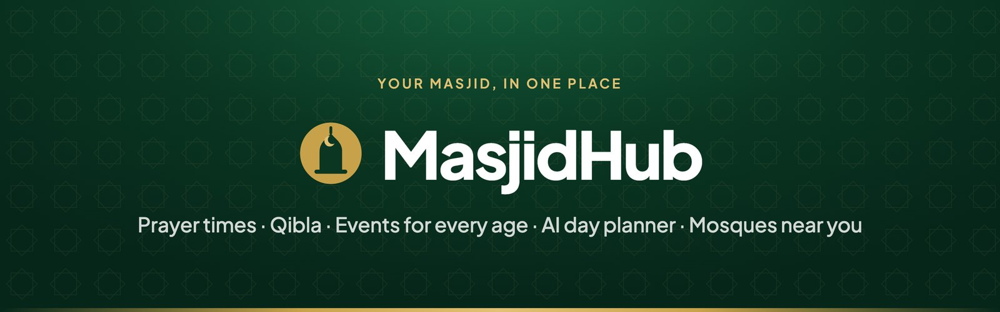
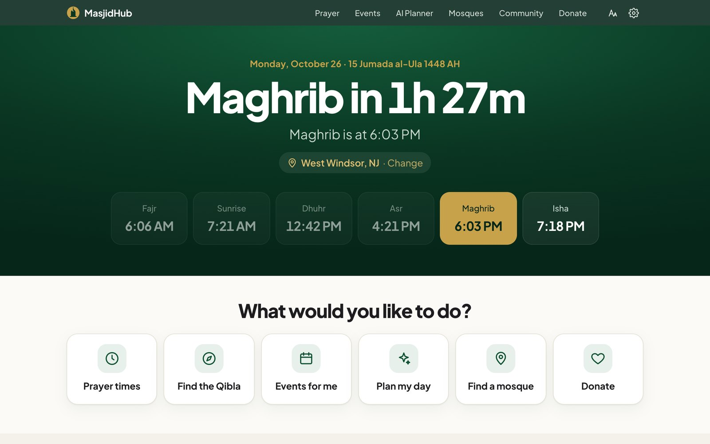
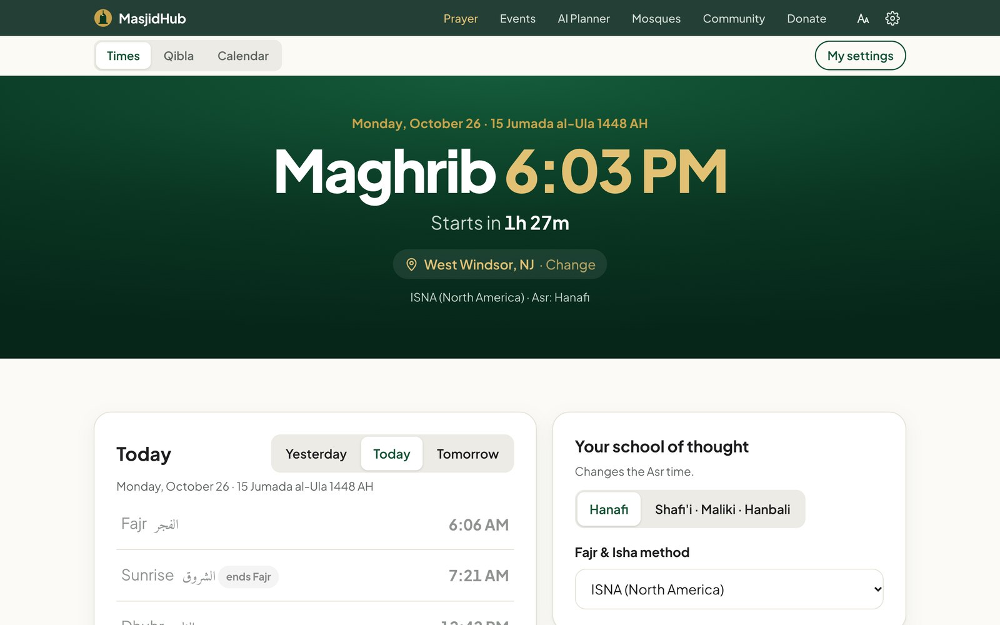
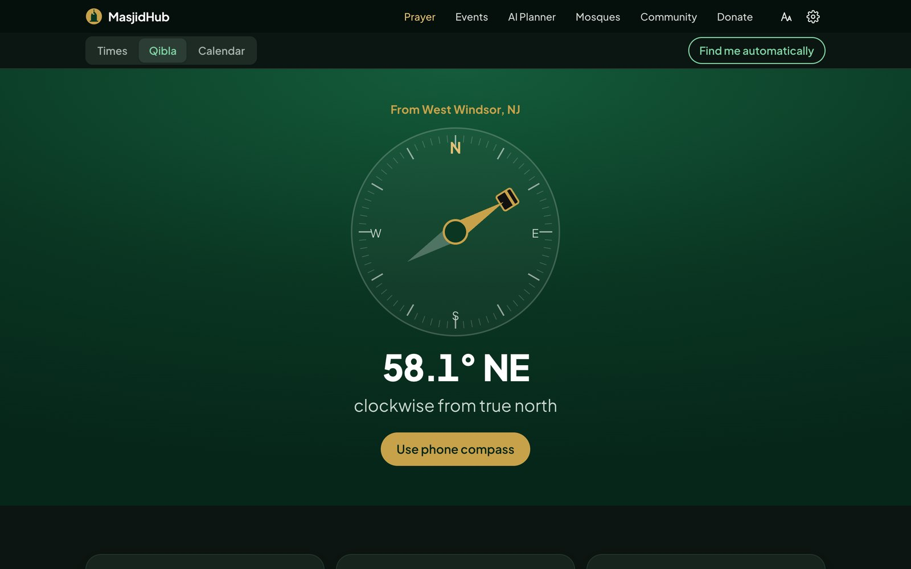
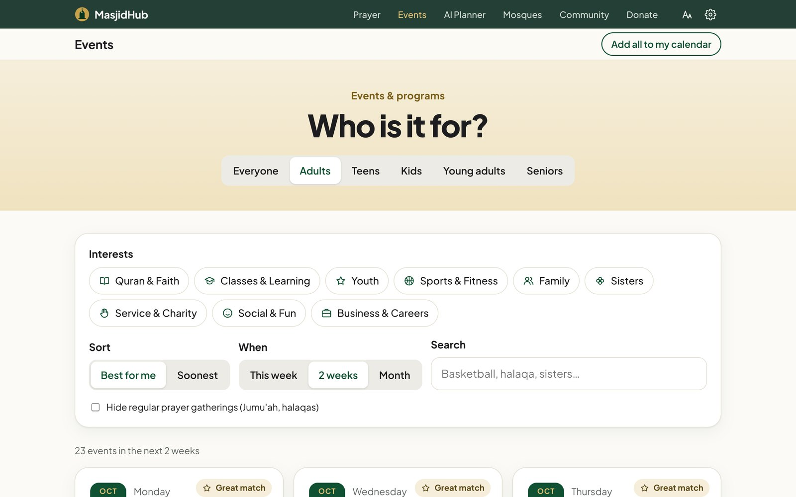
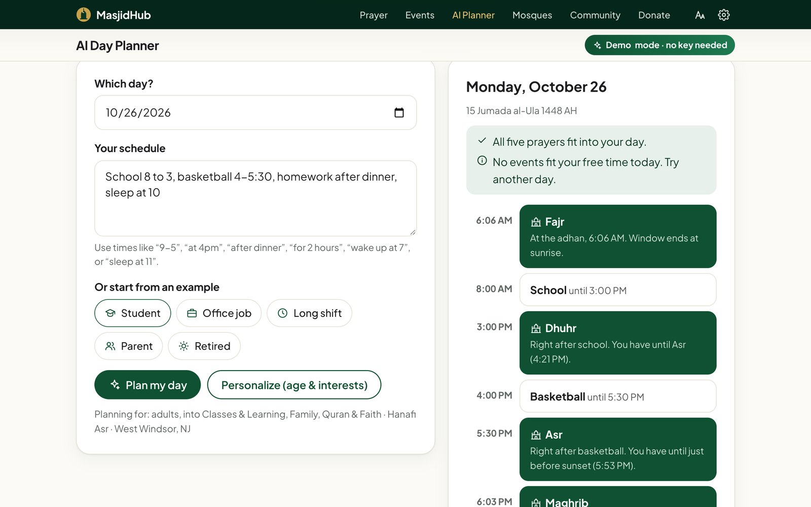
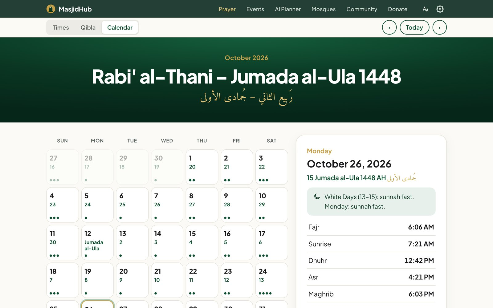
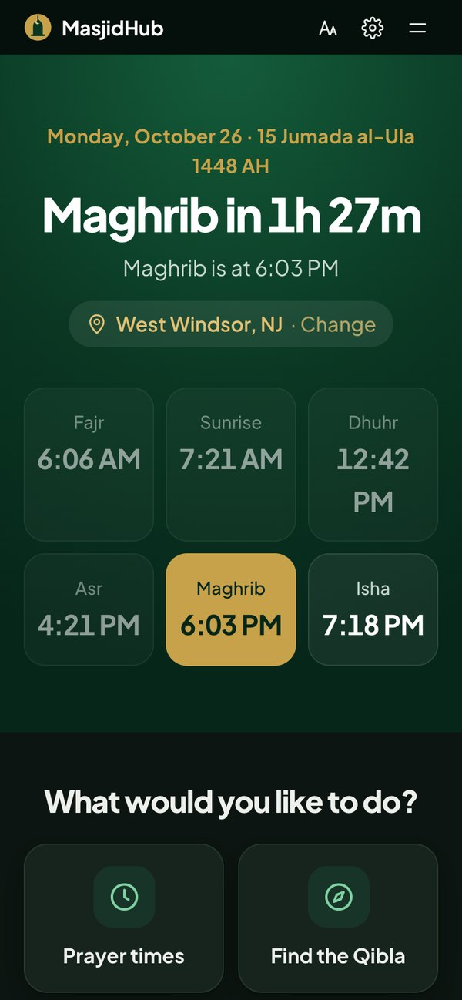

<p align="center">
  <a href="https://faarisaahmed.github.io/mc2/"></a>
</p>

<p align="center">
  <a href="https://faarisaahmed.github.io/mc2/"></a>
  &nbsp;
  <a href="#run-it-locally"></a>
</p>

<p align="center">
  
  
  
  
</p>

<br>

**MasjidHub** gives a mosque one clean, simple home for everything its community needs: accurate prayer times, the Qibla, events sorted by age and interest, an AI day planner that fits every salah into your schedule, a community space, a map of nearby mosques, an Islamic calendar, and donations. It is designed for every age, from grandparents to kids.

The demo is built around the **[Muslim Center of Greater Princeton (MCGP)](https://themuslimcenter.org)** in West Windsor, NJ.

> Most mosques don't have an organized app. People miss prayers and events (the ones that help them grow closer to Allah and to their community) because the information is scattered across flyers, group chats, and websites. MasjidHub puts it in one place and personalizes it for each person.

<br>

<picture>
  <source media="(prefers-color-scheme: dark)" srcset="docs/readme/home-dark.jpg">
  
</picture>

<br>

## Contents

- [Highlights](#highlights)
- [A closer look](#a-closer-look)
- [All features](#all-features)
- [Accuracy](#accuracy)
- [What is real and what is demo](#what-is-real-and-what-is-demo)
- [Run it locally](#run-it-locally)
- [Editing content](#editing-content)
- [Project structure](#project-structure)
- [Design](#design)
- [Accessibility](#accessibility)
- [Privacy](#privacy)
- [Roadmap](#roadmap)
- [Team](#team)
- [Credits](#credits)

## Highlights

<table>
  <tr>
    <td width="33%" valign="top">
      <h3>Accurate prayer times</h3>
      Calculated in the browser for any location. Checked against the Aladhan API across 136 city, season, and method combinations. Hanafi Asr by default.
    </td>
    <td width="33%" valign="top">
      <h3>Events for every age</h3>
      Adults, Teens, Kids, Young adults, and Seniors, filtered by interest and ranked by what suits you. Add any event to your own calendar.
    </td>
    <td width="33%" valign="top">
      <h3>A planner built around salah</h3>
      Type your day in plain words. MasjidHub fits each prayer into its valid window, flags conflicts, and suggests events you have time for.
    </td>
  </tr>
  <tr>
    <td width="33%" valign="top">
      <h3>Qibla, anywhere</h3>
      Exact bearing to the Kaaba, plus a live phone compass that tells you which way to turn.
    </td>
    <td width="33%" valign="top">
      <h3>Mosques near you</h3>
      Real mosques from OpenStreetMap on a calm map, with directions and each mosque's next prayer.
    </td>
    <td width="33%" valign="top">
      <h3>Simple for everyone</h3>
      One-question-per-screen setup, larger text in one tap, automatic dark mode, and big touch targets.
    </td>
  </tr>
</table>

## A closer look

<table>
  <tr>
    <td width="50%"><p align="center"><b>Prayer times</b><br><sub>Countdown, school of thought, and a monthly timetable</sub></p></td>
    <td width="50%"><p align="center"><b>Qibla</b><br><sub>58.1° from West Windsor, matching Aladhan</sub></p></td>
  </tr>
  <tr>
    <td width="50%"><p align="center"><b>Events</b><br><sub>Sorted by age group and interest</sub></p></td>
    <td width="50%"><p align="center"><b>AI Day Planner</b><br><sub>Prayers placed around school and sports</sub></p></td>
  </tr>
  <tr>
    <td width="50%"><p align="center"><b>Islamic calendar</b><br><sub>Hijri and Gregorian dates, fasting guidance</sub></p></td>
    <td width="50%" align="center"><p align="center"><b>On your phone</b><br><sub>Built for phones first, light or dark</sub></p></td>
  </tr>
</table>

## All features

| Feature | What it does |
|---|---|
| **Prayer times** | Fajr, Sunrise, Dhuhr, Asr, Maghrib, and Isha for any location, with a live countdown, a monthly timetable, printing, and optional adhan notifications. |
| **School of thought** | Hanafi by default (Asr when shadow = 2×), or Shafi'i, Maliki, and Hanbali (shadow = 1×). Seven Fajr and Isha methods: ISNA, MWL, Egypt, Umm al-Qura, Karachi, Tehran, and Jafari. |
| **Qibla finder** | Great-circle bearing to the Kaaba and a live phone compass (iOS and Android) that says "turn left" or "turn right" and vibrates when you face the Qibla. Shows the distance to Makkah. |
| **Events** | Adults, Teens, and Kids tabs (from the team's original sketch), plus Young adults and Seniors. Interest filters, a "Best for me" ranking, search, and `.ics` export. |
| **AI Day Planner** | Understands schedules like "School 8 to 3, soccer at 4:30, homework after dinner, sleep at 10:30". Places every prayer in its valid window, handles Jumu'ah on Fridays, and suggests matching events. |
| **Community** | Chat channels: General, Ask the Imam, Events & Carpools, Youth, Sisters, and Volunteers. |
| **Mosques near you** | Live map of real mosques from OpenStreetMap, with MasjidHub mosques pinned in gold. Distance, directions, and each mosque's next prayer. |
| **Add your mosque** | An application form that finds the address and adds the mosque to the map as "pending". |
| **Islamic calendar** | Gregorian and Hijri side by side, Islamic holidays, sunnah fasts (and the days fasting is not allowed), and prayer times for any day. |
| **Donations** | Give once, monthly, or every Friday to a chosen cause, plus a zakat calculator using the gold or silver nisab. |
| **Personal settings** | Location, school of thought, age, and interests, asked one simple question at a time. Change them any time in Settings. |
| **Text size and theme** | One button cycles normal, large, and extra-large text. Light and dark follow your device automatically, or can be fixed in Settings. |

## Accuracy

Prayer times are the part that matters most, so every number was checked against outside references.

**Prayer times**
- Calculated in the browser with the standard astronomical method most prayer apps use: sun declination and the equation of time, twilight angles for Fajr and Isha, and shadow length for Asr. See `prayerTimes()` in `assets/js/core.js`.
- Checked against the [Aladhan API](https://aladhan.com/prayer-times-api) for **136 combinations**: 5 cities (West Windsor, London, Karachi, Sydney, Oslo) × 4 seasons × 7 methods × both Asr schools.
  - Fajr, Sunrise, Dhuhr, Maghrib, and Isha **matched to the minute in every case**.
  - Asr matched in West Windsor. In a few far-from-equator cases it differed from Aladhan by 2 to 3 minutes, and an independent high-precision check (NOAA solar equations) found MasjidHub was the closer one. Example: London, 24 Oct 2026. Precise Asr 15:17:50, MasjidHub 15:18, Aladhan 15:20.
- High latitudes use the angle-based rule, the same default Aladhan uses.
- The site shows **adhan (start) times**. Iqamah is set by each mosque, so the site reminds people to confirm with their masjid.

**Hijri date**
- Uses the browser's built-in Umm al-Qura calendar (`Intl`, `islamic-umalqura`) with an arithmetic fallback for older browsers.
- Checked against Aladhan: 24 Oct 2026 = 13 Jumada al-Ula 1448.
- Local moon sighting can differ by a day, so Settings has a ±2 day adjustment.

**Qibla**
- Great-circle bearing to the Kaaba (21.4225° N, 39.8262° E). Matches Aladhan's Qibla API to two decimal places (58.12° from West Windsor).

<details>
<summary><b>Islamic dates, fasting, quotes, and zakat</b></summary>

<br>

**Holidays:** Islamic New Year, Ashura, Mawlid (labelled "observed by many"), Isra' & Mi'raj, Mid-Sha'ban, Ramadan, Laylat al-Qadr (27th, with a note to seek the odd nights), Eid al-Fitr, Hajj, the Day of Arafah, and Eid al-Adha.

**Fasting:** Ramadan is obligatory. Mondays and Thursdays, the White Days (13 to 15), Arafah, Ashura (9th and 10th), and six days of Shawwal are recommended. No fasting on the two Eids or the Days of Tashreeq (11 to 13 Dhu al-Hijjah). The White Day on 13 Dhu al-Hijjah is correctly overridden by Tashreeq.

**Quotes:**

| Quote | Source |
|---|---|
| "The example of those who spend their wealth in the way of Allah is like a seed which grows seven spikes…" | Qur'an, Al-Baqarah 2:261 |
| "Whoever builds a mosque for Allah, Allah will build for him something like it in Paradise." | Sahih al-Bukhari 450, Sahih Muslim 533 |
| The Prophet ﷺ disliked sleeping before Isha and talking after it. | Sahih al-Bukhari 568 |

**Zakat:** 2.5% of net zakatable wealth held for one lunar year, if at or above the nisab (85 g gold or 595 g silver). Metal prices change daily, so the calculator asks for today's price instead of guessing, and suggests asking a scholar about personal situations.

</details>

## What is real and what is demo

The team asked for a demo that needs no paid keys. Here is exactly what is real.

| Part | Status |
|---|---|
| Prayer times, Hijri dates, Qibla, fasting guidance | **Real**, verified (see [Accuracy](#accuracy)) |
| Mosque map | **Real** mosques from OpenStreetMap (free Overpass API) |
| City search and "Find me automatically" | **Real** (browser location and OpenStreetMap Nominatim) |
| MCGP info, services, education, contacts, dated events | **Real**, from [themuslimcenter.org](https://themuslimcenter.org) |
| Recurring program times | Some are **placeholders**, and those event cards say "Sample time. Confirm with the mosque." Programs tied to a prayer ("after Isha") follow the real prayer time. |
| AI Day Planner | **Demo engine.** A rule-based planner that runs in the browser with no API key. It really checks prayer windows, but it is not a large language model. |
| Community chat | **Demo.** Messages stay in your browser. Sample posts are labelled. "Ask the Imam" never invents answers from a real person. |
| Donations | **Demo.** No card details are collected and nothing is charged. Every donate screen links to MCGP's real donation page. |
| Add your mosque | **Demo.** Applications are saved in your browser and show on your map as "pending". |

## Run it locally

No build step, no framework, and no `npm install`.

```bash
git clone https://github.com/faarisaahmed/mc2.git
cd mc2
python3 -m http.server 8000
# open http://localhost:8000
```

Use a local server rather than opening the files directly, because location and some browser features need `http://`. The phone compass needs HTTPS (GitHub Pages provides it) and a phone with a compass sensor.

**Deploying:** push to `main`. GitHub Pages serves the repository root and updates within a minute or two.

## Editing content

Almost everything you would want to change lives in **`assets/js/data.js`**: mosques, events, donation causes, services, and contacts.

<details>
<summary><b>Add a one-time event</b></summary>

```js
{ id: "bake-sale", title: "Youth Bake Sale", date: "2026-11-21", start: "12:00", end: "15:00",
  ages: [0, 120], audience: "all", interests: ["youth", "service"],
  cost: "Free entry", place: "MCGP lobby", desc: "Support the youth trip!" }
```
</details>

<details>
<summary><b>Add a weekly event</b></summary>

```js
recur: { days: [6], from: "2026-11-01", to: "2027-01-31" }   // days: 0=Sun … 6=Sat; add every: 2 for every other week
```
</details>

<details>
<summary><b>Tie an event to a prayer</b> (it moves with the prayer time)</summary>

```js
after: "isha", mins: 60          // starts ~20 min after Isha, lasts 60 min; add offset: 15 to change the gap
```
</details>

<details>
<summary><b>Field reference</b></summary>

| Field | Meaning |
|---|---|
| `ages: [min, max]` | Ages the event is for. `[0, 120]` means all ages. |
| `audience` | `all`, `sisters`, `brothers`, or `girls` |
| `interests` | Any of `faith`, `learning`, `youth`, `sports`, `family`, `sisters`, `service`, `social`, `business` |
| `sample: true` | Shows the "Confirm with the mosque" note |
</details>

## Project structure

```
.
├── index.html            Home
├── prayer.html           Prayer times
├── qibla.html            Qibla compass
├── calendar.html         Islamic calendar
├── events.html           Events by age and interest   (?age=kids, ?interest=sports)
├── planner.html          AI day planner              (?add=<eventKey>&date=YYYY-MM-DD)
├── community.html        Community chat
├── map.html              Mosques near you (Leaflet)
├── join.html             Add your mosque
├── donate.html           Donations and zakat calculator
├── mosque.html           MCGP profile page
├── assets/
│   ├── css/site.css      All styles (design tokens at the top)
│   ├── js/boot.js        Applies saved theme and text size before the page paints
│   ├── js/core.js        Shared engine: settings, prayer math, Hijri, Qibla, icons, nav, setup
│   ├── js/data.js        Mosques, events, interests, age groups   ← edit content here
│   ├── js/planner.js     Day planner engine (schedule parser and prayer placement)
│   └── img/icon.svg      Logo and favicon
└── docs/readme/          Images used in this README
```

Every page is plain HTML that loads `data.js` and `core.js`, then runs its own small script. The only external library is [Leaflet](https://leafletjs.com) 1.9.4 on the map page, with Esri's Light and Dark Gray Canvas tiles (no key needed), which swap with the theme.

## Design

- **Colors:** the masjid's green and gold. Tokens live at the top of `site.css`: `--green #0f5132`, `--green-deep #0a3622`, `--gold #c8a24a`.
- **Type:** [Plus Jakarta Sans](https://fonts.google.com/specimen/Plus+Jakarta+Sans) for everything, with [Amiri](https://fonts.google.com/specimen/Amiri) for Arabic text and ﷺ.
- **Layout:** a thin top bar with six grouped sections (Prayer holds Times, Qibla, and Calendar; Mosques holds the Map and Add yours), large headline tiles, and an "eyebrow, headline, subhead, then two actions" pattern.
- **Icons:** one consistent set of simple line icons, and no emoji, so the site looks the same on every device.
- **Light and dark:** every color is a token, redefined for dark mode. `boot.js` applies a forced theme before the page draws, so there is no flash.

## Accessibility

- Larger text in one tap on every page, remembered for next time
- Step-by-step setup with one question per screen and big Back and Next buttons
- A "What would you like to do?" row of six large buttons on the home page
- Automatic dark mode, easier on the eyes at Fajr and Isha
- Touch targets of 44px or more and plain-language labels
- Visible keyboard focus, `aria-pressed` toggles, `aria-live` countdowns, and labelled form fields
- Honors reduced-motion settings
- Works at phone width (tested at 390px) with no sideways scrolling
- Printable monthly timetable

## Privacy

No accounts, cookies, or analytics. Settings, planner drafts, chat messages, and applications are stored only in your browser's `localStorage`. Network requests go only to map services (Esri tiles, OpenStreetMap Overpass and Nominatim), and only when you use those features.

## Roadmap

1. **Real AI planner.** Send the schedule, prayer windows, and candidate events to a language model through a small server that holds the API key, keeping the current engine as the offline fallback.
2. **Mosque dashboard.** Approved mosques sign in to post events, set iqamah and Jumu'ah times, and manage causes.
3. **Real chat.** A moderated backend with sign-in, reporting, and imam-verified answers.
4. **Real payments.** Connect each mosque's own provider (Stripe, PayPal, LaunchGood).
5. **Installable app.** A PWA with offline prayer times and adhan reminders.

## Team

MasjidHub was designed and built by:

- **Faaris Ahmed**, repository owner
- **Marium Anwar**
- **Zoya Anwar**
- **Mariam Padela**
- **Tarik Tasgetiren**
- **Nasir Munir**

## Credits

- Built for and around the **Muslim Center of Greater Princeton**, 2030 Old Trenton Rd, West Windsor Township, NJ 08550 · [themuslimcenter.org](https://themuslimcenter.org) · (609) 336-7602
- Mosque data © [OpenStreetMap](https://www.openstreetmap.org/copyright) contributors · Map tiles © Esri · Map library [Leaflet](https://leafletjs.com)
- Verification data from the [Aladhan API](https://aladhan.com)
- Fonts: Plus Jakarta Sans and Amiri (Google Fonts)

<br>

<p align="center"><sub>MasjidHub is a student and community project, not an official MCGP product. Always confirm prayer and event times with your mosque.</sub></p>
